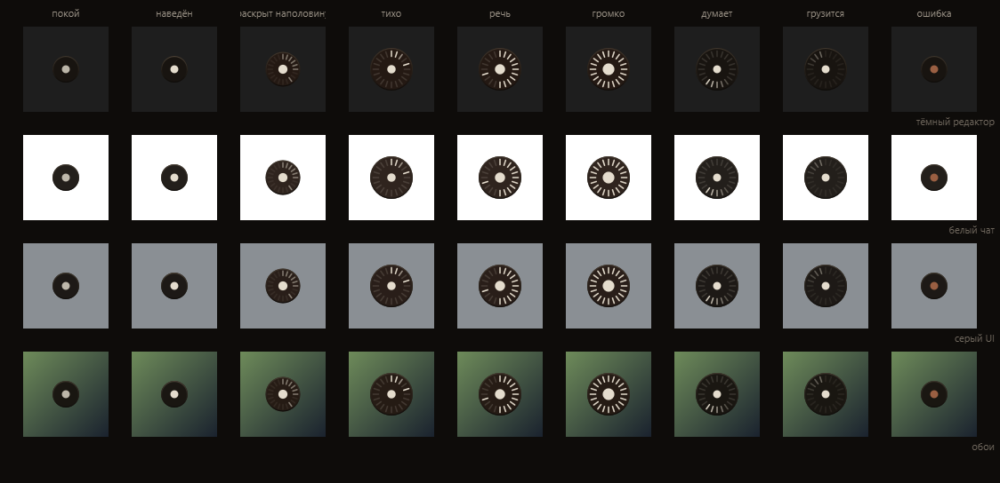

# dot

Минималистичная и сверхбыстрая голосовая диктовка для Windows.  
Нажал хоткей — сказал — текст мгновенно появился там, где стоит курсор, и сохранился в буфере обмена (`Ctrl+V`).

Точка живёт поверх окон, не забирает фокус и не мешает работе. Пока слушает — раскрывается и показывает живой уровень громкости с микрофона.



---

## Как это устроено

* **Скорость:** ~0.2–0.4 секунды на фразу через облачный движок Groq Whisper (`whisper-large-v3-turbo` на LPU).
* **0 МБ видеопамяти:** видеокарта свободна для игр, рендера и рабочих задач.
* **0 ГБ на диске:** не нужно выкачивать многогигабайтные веса нейросетей.
* **25 МБ ОЗУ в фоне:** легковесный процесс тихо ждёт хоткея в автозагрузке.
* **Двойная надёжность вставки:** текст вставляется прямо в активное поле ввода под курсор и одновременно копируется в буфер обмена (если фокус окна соскочил — просто жмёшь `Ctrl+V`).

---

## Горячие клавиши

| Хоткей | Действие |
| :--- | :--- |
| **`Ctrl + Alt + D`** | **Диктовка:** нажал (точка раскрылась и слушает) → сказал → нажал ещё раз (текст вставился). |
| **`Клик левой кнопкой`** | Альтернатива хоткею: включить / выключить запись кликом по точке. |
| **`Клик правой кнопкой`** | Во время записи — отменить и стереть аудио без расшифровки; в покое — меню статуса. |
| **`Ctrl + Alt + F`** | **Обучить:** скопировал исправленный текст в буфер обмена (`Ctrl+C`), нажал хоткей — dot запомнит разницу. |

---

## Как он учится

Тяжёлое дообучение модели не нужно: 99% ошибок в речи происходят на личных именах, брендах и специфических терминах. Dot решает это на лету двумя файлами:

* **`vocab.txt`** — твой персональный словарь. Передаётся в Whisper отдельным контекстным промптом, поэтому модель перестаёт коверкать термины (*«Astana Hub»*, *«Double»*, фамилии и стек технологий).
* **`corrections.json`** — правила автозамены после распознавания, если фонетически слово всё равно проскочило не так.

Оба файла пополняются автоматически:
1. Продиктовал фразу.
2. Увидел ошибку, исправил руками прямо в тексте.
3. Выделил и скопировал правильный вариант (`Ctrl+C`).
4. Нажал **`Ctrl+Alt+F`**.
5. Dot сравнит исправленный текст со своей последней расшифровкой, выделит разницу и сам запишет нужное слово в `vocab.txt` и `corrections.json`.

---

## Быстрый старт

### 1. Установка зависимостей

Требуется Python 3.10+:

```powershell
python -m venv .venv
.\.venv\Scripts\pip install -r requirements.txt
```

### 2. Запуск

```powershell
.\.venv\Scripts\pythonw dot.py
```

Точка появится в правом нижнем углу экрана (её можно перетащить мышкой в любое удобное место — позиция запомнится).

---

## Настройка

Все параметры хранятся в `state.json` рядом со скриптом:

```json
{
  "backend": "groq",
  "groq_model": "whisper-large-v3-turbo",
  "groq_api_key": "твой_бесплатный_ключ_groq"
}
```

* `groq_model` — по умолчанию `whisper-large-v3-turbo` (самый быстрый), можно переключить на `whisper-large-v3`.
* `history.jsonl` — локальный журнал всех твоих расшифровок с таймстемпами.
* `last.wav` — последняя записанная фраза (для проверки микрофона или калибровки).
